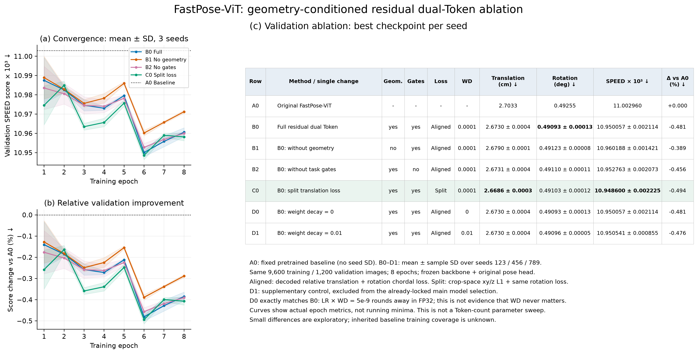
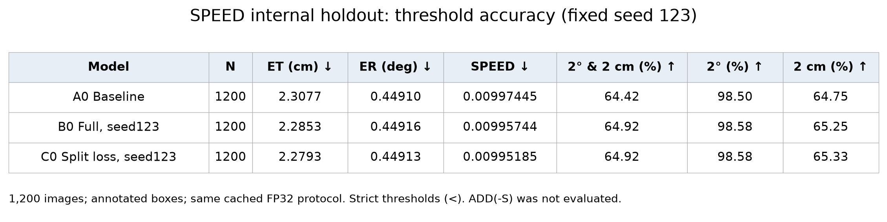

# 双 Token 消融实验表与曲线

主表使用验证集、3个随机种子的最佳轮次结果；测试表只列实际有逐图预测的3个模型，不能把它当作全部结构的测试消融。所有误差指标越低越好，阈值准确率越高越好。

| 编号 | 配置 | 平移cm（均值±SD） | 旋转°（均值±SD） | SPEED×1000（均值±SD） | 相对基线变化% |
|---|---|---|---|---|---|
| A0 | Original FastPose-ViT | 2.7033 | 0.49255 | 11.002960 | +0.000 |
| B0 | Full residual dual Token | 2.6730 ± 0.0004 | 0.49093 ± 0.00013 | 10.950057 ± 0.002114 | -0.481 |
| B1 | B0: without geometry | 2.6790 ± 0.0001 | 0.49123 ± 0.00008 | 10.960188 ± 0.001421 | -0.389 |
| B2 | B0: without task gates | 2.6731 ± 0.0004 | 0.49110 ± 0.00011 | 10.952763 ± 0.002073 | -0.456 |
| C0 | B0: split translation loss | 2.6686 ± 0.0003 | 0.49103 ± 0.00012 | 10.948600 ± 0.002225 | -0.494 |
| D0 | B0: weight decay = 0 | 2.6730 ± 0.0004 | 0.49093 ± 0.00013 | 10.950057 ± 0.002114 | -0.481 |
| D1 | B0: weight decay = 0.01 | 2.6730 ± 0.0004 | 0.49096 ± 0.00005 | 10.950541 ± 0.000855 | -0.476 |

A0为固定基线，无跨种子标准差。B0–D1各3种子、每次8轮。C0按主实验验证均值选出；D1是后补数值对照，不参与已锁定模型的选择。B0和D0参数完全相同是当前LR×WD在FP32下舍入造成，不是一般性结论。

## 测试阈值准确率

| 模型 | 2°且2cm准确率% | 2°准确率% | 2cm准确率% |
|---|---|---|---|
| A0 Baseline | 64.42 | 98.50 | 64.75 |
| B0 Full, seed123 | 64.92 | 98.58 | 65.25 |
| C0 Split loss, seed123 | 64.92 | 98.58 | 65.33 |

阈值采用严格小于。没有CAD点匹配评估结果，因此不添加ADD(-S)列；也不把不同量纲的误差混成MEAN。

## 曲线与使用说明

- validation_curves：横轴是真实训练轮次，线为3种子平均，阴影为样本标准差；曲线未平滑，未改成累计最优。
- robustness_curves：框偏移0/10/20%与亮度0.5/1/1.5，是固定模型的鲁棒性曲线，不是Token数量扫描。相邻测点间连线仅用于阅读。
- ablation_overview：左侧两幅曲线与右侧主表组合，接近参考文献的版式；指标保持本项目实际口径。
- PNG为高分辨率图片，SVG为可编辑矢量图；CSV保存精确数值；validation_ablation.tex可插入LaTeX（需booktabs）。

原始数据：../results/validation_runs.json、../results/supplement/validation_runs.json、各组history.json及clean_*_errors.npy。

本轮属于小预算冻结分支消融，非从头训练或完整收敛结果。小幅差异不能单独证明创新；已有基线的训练覆盖范围未知，内部测试集也不是官方盲测。
